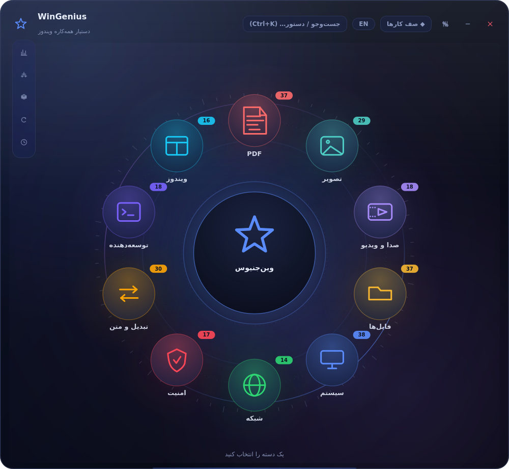
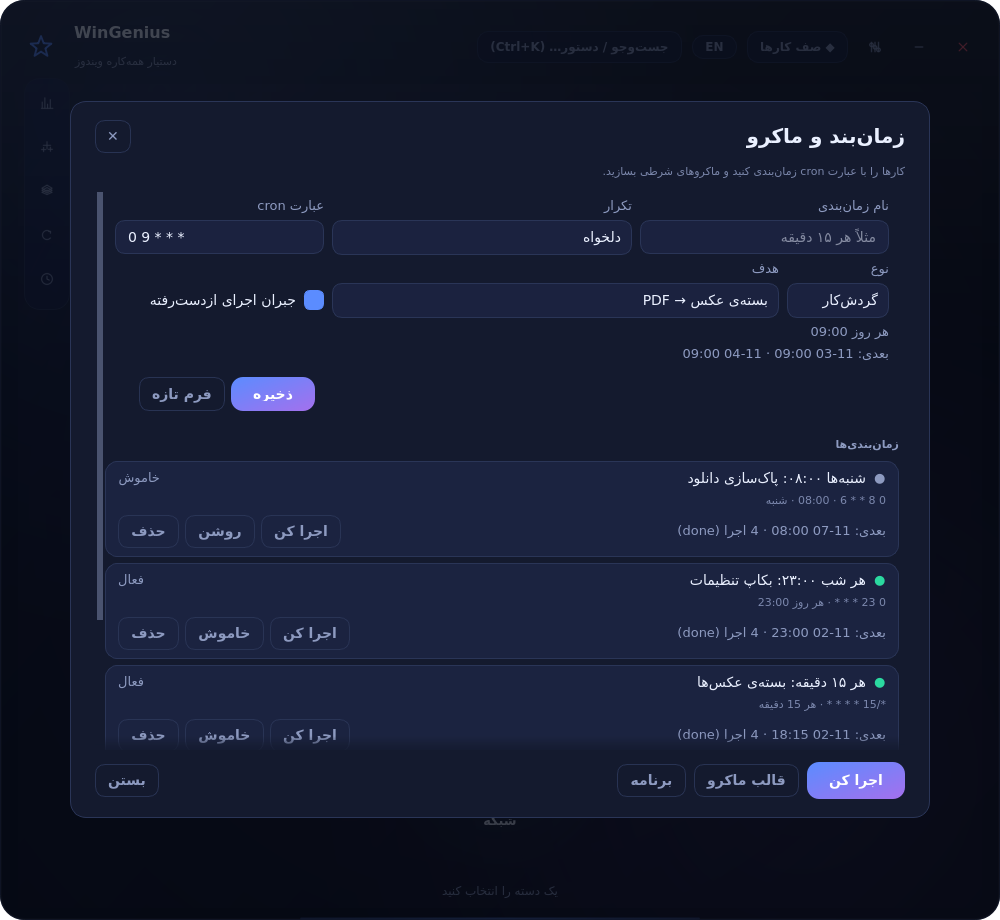
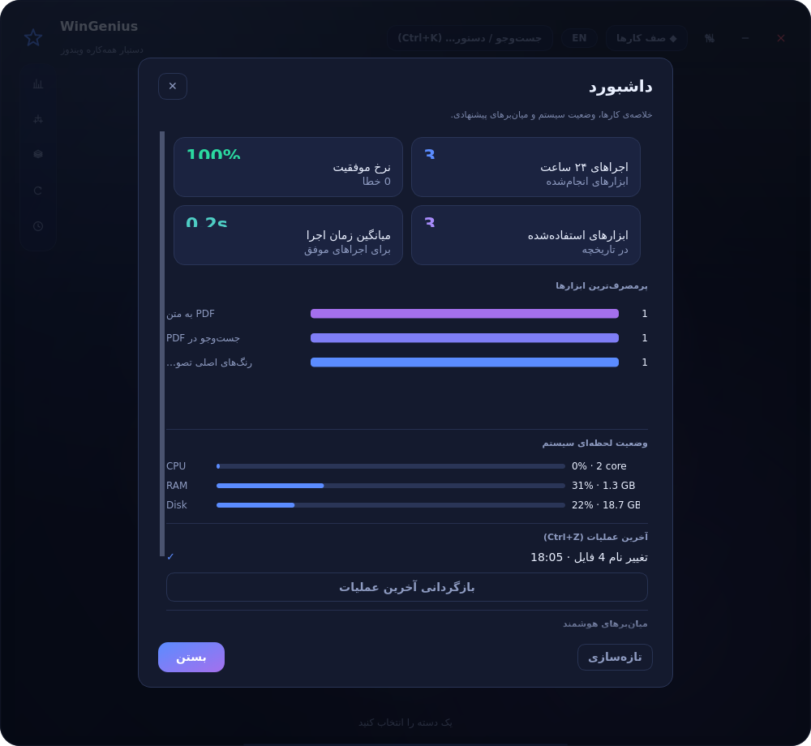
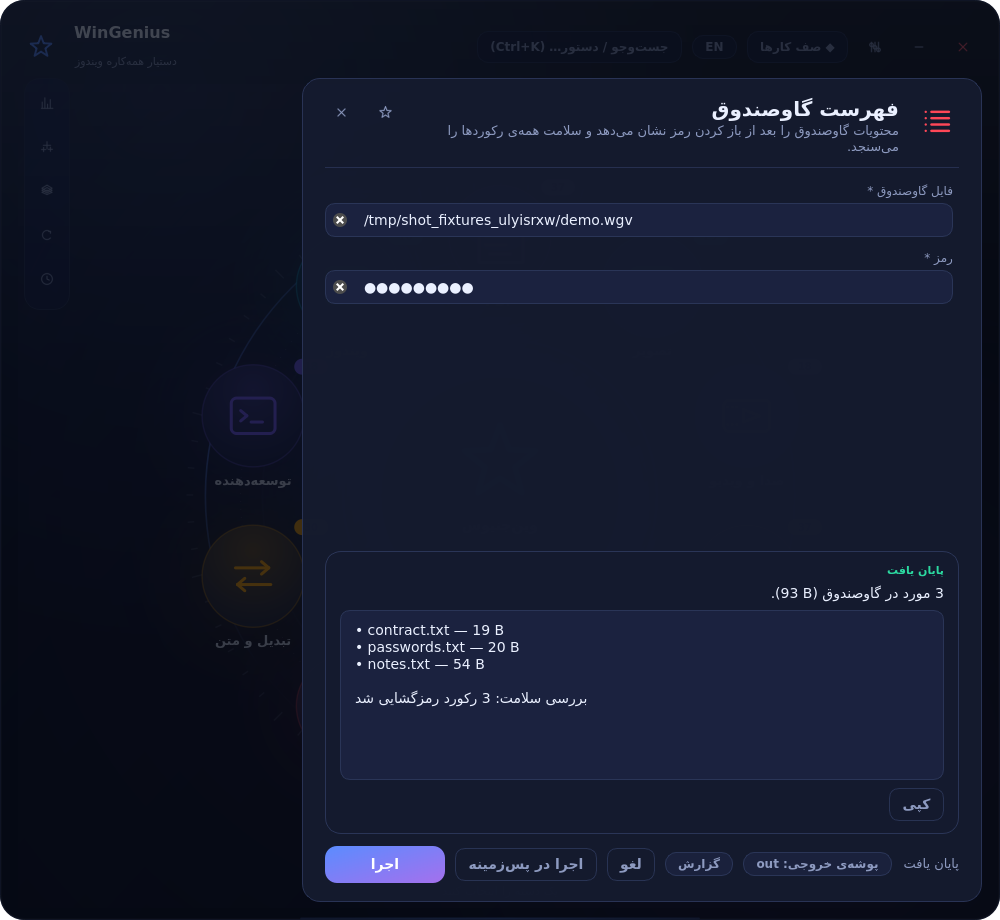
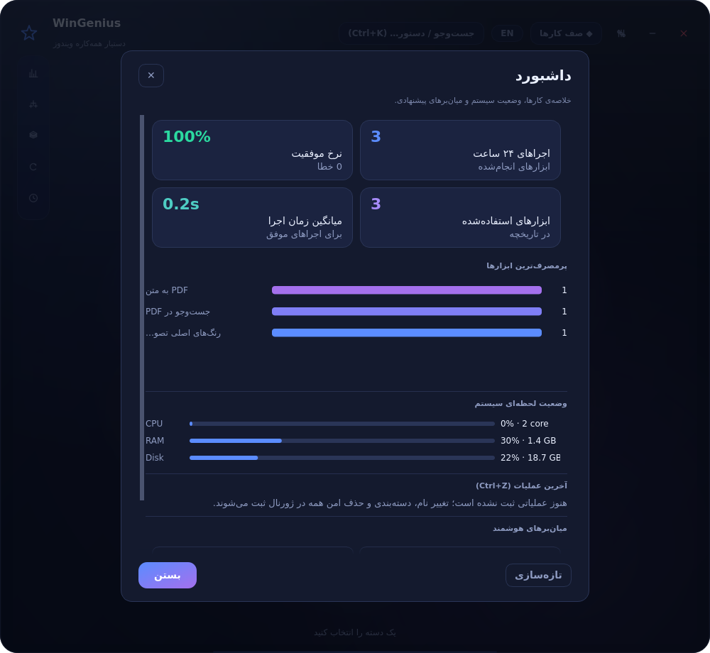
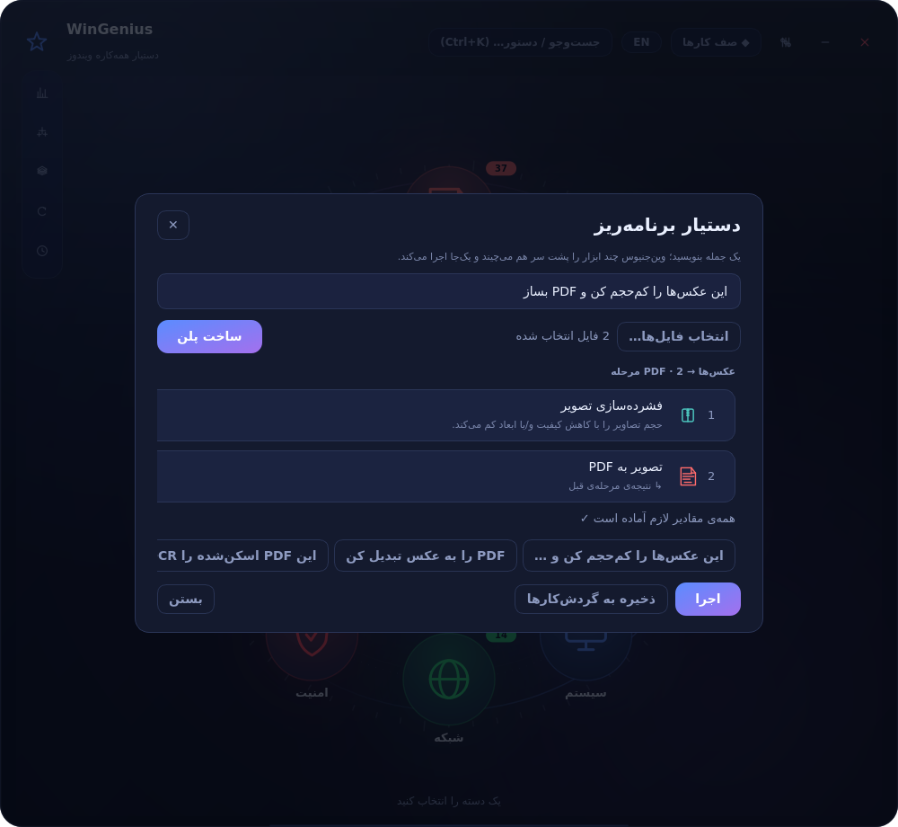
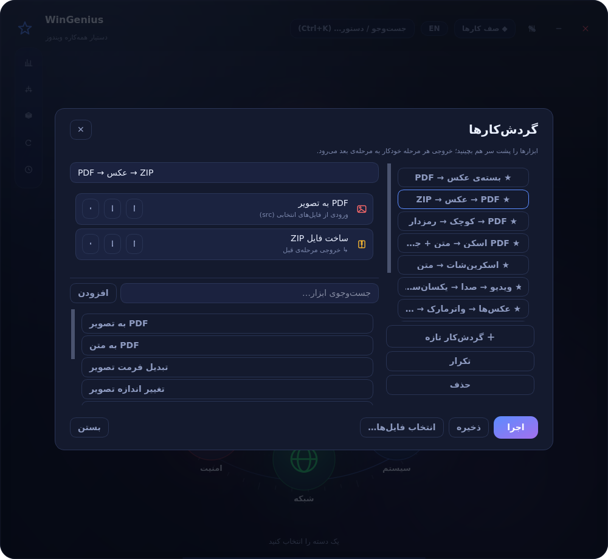
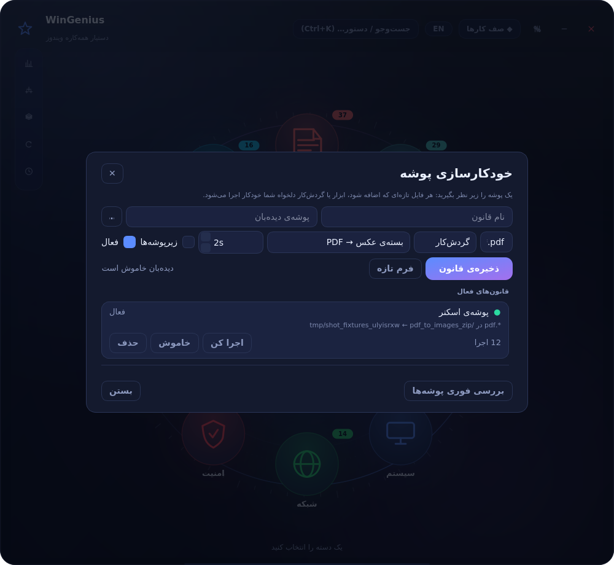

# WinGenius 5.0 — دستیار همه‌کاره ویندوز

<p align="center">
  <a href="https://github.com/Pillow1243/WinGenius/actions/workflows/ci.yml"></a>
  
  
  
  
  
  <a href="../../releases/latest"></a>
</p>

> **۲۵۴ ابزار** در ۱۰ دسته · **گاوصندوق رمزدار (AES-256-GCM + scrypt)** · **ژورنال و بازگردانی (Ctrl+Z)** ·
> **زمان‌بند cron** · **موتور ماکرو شرطی** · **API محلی JSON** · به‌همراه همه‌ی نسخه‌ی ۳:
> دستیار برنامه‌ریز، گردش‌کارها، خودکارسازی پوشه، ایندکس جست‌وجو، هوش کلیپ‌بورد و داشبورد زنده.
>
> **نسخه‌ی ۵.۰ — «امضا، جست‌وجوی هوشمند، گزارش خطا»:** امضای دیجیتال PDF با گواهی PKCS#12
> و **تشخیص دستکاری بعد از امضا**، ایندکس جست‌وجویی که PDFهای **اسکن‌شده** را هم با OCR
> می‌خواند، بسته‌ی گزارش خطا با حذف مسیرها و رمزها، و ۶۵ بررسی تازه‌ی امنیتی و مقیاس.
>
> نسخه‌های ۴.۲ و ۴.۱ هم در همین نسخه هستند: حذف واقعی محتوا (redaction)، گفتار به متن با
> Whisper، OCR یک‌کلیکی، «ارسال به» ویندوز، حالت پرتابل، گاوصندوق نسل‌دوم با `scrypt`،
> نسخه‌بندی/مهاجرت داده با پشتیبان، سقف نرخ API و مجوز شفاف `AGPL-3.0`.

<p align="center">
  
  
</p>
<p align="center">
  
  
</p>
<p align="center">
  
  
</p>
<p align="center">
  
  
</p>

> صفحه‌ی معرفی کامل و مستقل (بدون اینترنت) در [`docs/showcase.html`](docs/showcase.html) ·
> خلاصه‌ی فارسی نسخه‌ی ۴ در [`docs/summary_v4_fa.md`](docs/summary_v4_fa.md) ·
> یادداشت نسخه‌ی ۵.۰ در [`docs/summary_v5_fa.md`](docs/summary_v5_fa.md) ·
> یادداشت نسخه‌ی ۴.۲ در [`docs/summary_v4_2_fa.md`](docs/summary_v4_2_fa.md) ·
> یادداشت نسخه‌ی ۴.۱ در [`docs/summary_v4_1_fa.md`](docs/summary_v4_1_fa.md) ·
> راهنمای گام‌به‌گام نصب در [`docs/install_fa.md`](docs/install_fa.md) ·
> English entry point: [`docs/README.en.md`](docs/README.en.md).

---

## ۱. چه چیزی در نسخه‌ی ۵.۰ اضافه شد؟

| قابلیت | توضیح |
|---|---|
| **امضای دیجیتال PDF** | `pdf_sign` با گواهی PKCS#12 (`.p12/.pfx`) امضای رمزنگاری‌شده می‌گذارد — نه عکسِ امضا. `pdf_signature_check` هر امضا را فهرست می‌کند، امضاکننده و پوشش را می‌گوید و **اگر بعد از امضا چیزی در فایل تغییر کرده باشد هشدار می‌دهد** (پوشش از `ENTIRE_FILE` به `ENTIRE_REVISION` می‌افتد). |
| **جست‌وجو در PDFهای اسکن‌شده** | ایندکس FTS5 حالا PDFهایی را که لایه‌ی متن ندارند تشخیص می‌دهد (متن کم + تصویر بزرگ روی صفحه)، صفحه‌های اول را رندر و با Tesseract می‌خواند و متن را ایندکس می‌کند. نتیجه در آمار ایندکس جداگانه شمرده می‌شود و با یک کلید در تنظیمات خاموش‌شدنی است. |
| **بسته‌ی گزارش خطا** | `crash_report` یک ZIP با نسخه، وضعیت وابستگی‌ها و انتهای لاگ می‌سازد و **مسیر خانه، نام کاربری و توکن/رمز را حذف می‌کند** — چیزی که می‌شود بی‌نگرانی برای کسی فرستاد. |
| **۶۵ بررسی تازه** | ۱۰ بررسی خروجی برای امضا/دستکاری، ۱۸ بررسی موتور برای ۵.۰، ۹ بررسی **مقیاس** (۶۰۰ فایل تغییر نام + بازگردانی، ایندکس ۲۵۰ سند با زمان‌سنجی) و بررسی دسترس‌پذیری همه‌ی فرم‌ها. |

### نسخه‌ی ۴.۲ (در همین نسخه)

| قابلیت | توضیح |
|---|---|
| **حذف واقعی محتوا از PDF** | ابزار تازه‌ی «Redaction»: عبارت یا ناحیه را انتخاب می‌کنید و متن **از محتوای فایل پاک می‌شود**، نه این‌که زیر یک مستطیل سیاه پنهان شود. بعد از ذخیره، خودِ ابزار دوباره فایل را باز می‌کند و تأیید می‌کند که عبارت دیگر استخراج نمی‌شود. (تفاوتش با «سیاه‌کردن» ظاهری همان تفاوت امنیت با تظاهر است.) |
| **گفتار به متن + زیرنویس خودکار** | صدا یا ویدیو → متن و/یا `.srt` با Whisper، کاملاً محلی (هیچ آپلودی نیست). اگر موتور نصب نباشد، پیام دقیق نصب می‌دهد نه خطای خام. |
| **OCR بدون دردسر** | ابزار «راه‌اندازی OCR»: وضعیت موتور را می‌گوید، مسیر نصب غیرمعمول را ثبت می‌کند و بسته‌ی زبان فارسی/عربی را **دانلود** می‌کند. الان همه‌ی ابزارهای OCR از همان مسیر استفاده می‌کنند (قبلاً فقط `PATH` را می‌دیدند). |
| **«ارسال به» ویندوز** | یک میان‌بر در منوی راست‌کلیک Explorer: روی هر فایلی «Send to → WinGenius» بزنید و همان فایل‌ها داخل صفحه‌ی پیشنهاد هوشمند باز می‌شوند (`--install-sendto` از خط فرمان هم هست). |
| **حالت پرتابل** | با `--portable`، متغیر `WINGENIUS_PORTABLE=1` یا یک فایل `portable.flag` کنار exe، همه‌ی داده‌ها کنار برنامه می‌نشینند (فلش، سیستم مشترک، بدون اثر در پروفایل). |
| **دسترس‌پذیری** | هر فیلد فرم و هر دکمه‌ی نوار کناری نام دسترس‌پذیر و توضیح دارد و با تغییر زبان به‌روز می‌شود — تا صفحه‌خوان‌ها «ویرایشگر بی‌نام» نگویند. تست‌ها همه‌ی ۵۰۰+ فیلد را بازبینی می‌کنند. |
| **۳۸ بررسی تازه‌ی خروجی** | پوشش خروجی برای ابزارهای PDF که قبلاً فقط «کرش نکردن»شان تست می‌شد: شماره‌صفحه، متادیتا، جست‌وجو، Markdown، صفحه‌ی خالی، ترتیب صفحه، برش (CropBox)، جزوه و پوستر. |

نسخه‌ی ۴.۱ (در همین نسخه هم هست) نسخه‌ی «سخت‌سازی و توزیع» بود — بدون قابلیت نمایشی تازه، ولی با
تفاوت‌هایی که در استفاده‌ی واقعی حس می‌شوند:

| قابلیت | توضیح |
|---|---|
| **گاوصندوق نسل‌دوم** | کلید با **scrypt** (`N=2¹⁵`) ساخته می‌شود، هدر (پارامترهای KDF + salt) با GCM **احراز** می‌شود، و هر باند داده به نام رکوردش گره خورده است. گاوصندوق‌های قدیمی باز می‌شوند و با ابزار تازه‌ی «ارتقای گاوصندوق» (ابزار هفدهم امنیت) به قالب تازه می‌آیند. |
| **نسخه‌بندی داده + مهاجرت** | پوشه‌ی داده `schema.json` دارد، هر مهاجرت **قبل از اجرا** پشتیبان کامل می‌گیرد، قدم‌ها idempotent‌اند و ژورنال با `PRAGMA user_version` در جا ارتقا می‌یابد. |
| **تک‌نسخه‌ای** | باز کردن نسخه‌ی دوم، پنجره‌ی نسخه‌ی اول را جلو می‌آورد و خودش خارج می‌شود — دیگر دو نسخه روی یک ژورنال و زمان‌بند نمی‌جنگند. |
| **API محلی مقاوم** | سقف نرخ (۳۰۰/دقیقه)، سقف بدنه‌ی ۱ مگابایت با پاسخ واقعی `413`، توکن قابل‌غیرفعال‌سازی در query، و بستن درست سوکت هنگام خاموشی. |
| **تست درستی خروجی** | مجموعه‌ی تازه‌ی `tests/output_test.py` (۸۰ بررسی) خودِ فایل تولیدشده را باز می‌کند و می‌سنجد. |
| **CI و ابزار کیفیت** | GitHub Actions روی ویندوز+لینوکس و پایتون ۳.۱۱+۳.۱۳، `ruff` با قواعد خطای واقعی، و `packaging/verify_package.py` برای هم‌خوانی فایل‌های ساخت. |
| **مجوز شفاف** | `LICENSE` (AGPL-3.0)، `THIRD-PARTY-NOTICES.md` با مسیر رسیدن به مجوز سهل‌گیرانه، و صفحه‌ی مجوز در نصب‌کننده. |
| **باگ‌های واقعی رفع‌شده** | `zip-slip`، `NameError` در پایان برش صدا، `NameError` در اجرای ماکرو، f-string نامعتبر روی پایتون ۳.۱۱، `--dry-run` که در فراخوانی برنامه‌ای واقعاً اجرا می‌کرد، و «فشرده‌سازی» که فایل بزرگ‌تر تحویل می‌داد. |

نسخه‌ی ۴ هم سه چیز را حل کرد که هیچ دستیار ویندوزی یک‌جا ندارد: **امنیت داده**
نسخه‌ی ۴ سه چیز را حل می‌کند که هیچ دستیار ویندوزی یک‌جا ندارد: **امنیت داده**
(گاوصندوق رمزدار)، **بازگشت‌پذیری** (هر تغییر فایل قابل برگشت است) و **تکرار خودکار**
(زمان‌بند cron + ماکروهای شرطی + API محلی برای اتصال به بقیه‌ی برنامه‌ها) — خلاصه‌ی نسخه‌ی ۴:

| قابلیت | توضیح |
|---|---|
| **گاوصندوق رمزدار** | فایل `.wgv` با `AES-256-GCM` و کلید `PBKDF2-HMAC-SHA256` (۲۴۰٬۰۰۰ تکرار). هر فایل یا یادداشت **جداگانه** رمز می‌شود، تغییر رمز همه‌چیز را از نو رمز می‌کند، و «بررسی سلامت» تک‌تک رکوردها را رمزگشایی می‌کند. شش ابزار: ساخت، افزودن، فهرست، استخراج، حذف، تغییر رمز. |
| **ژورنال و بازگردانی (Ctrl+Z)** | تغییر نام گروهی، دسته‌بندی خودکار و صاف‌کردن پوشه در ژورنال SQLite ثبت می‌شوند؛ با یک کلید (یا دکمه‌ی داشبورد) عیناً برمی‌گردند. حذف‌ها به **سطل بازیافت داخلی** می‌روند، نه نیستی. |
| **زمان‌بند cron** | عبارت cron معتبرسنجی و به فارسی خوانده می‌شود («هر روز ۹ صبح»)، اجرای ازدست‌رفته بعد از خاموش‌بودن سیستم جبران می‌شود، هر زمان‌بندی هدفش گردش‌کار، ابزار یا ماکرو است. شیت کامل + `Ctrl+5`. |
| **موتور ماکرو** | DSL شرطی: `copy / move / delete / mkdir / write / run / foreach / if / else / sleep / log`، متغیرها، glob، اجرای ابزارها و گردش‌کارها، **اجرای تمرینی** و اعتبارسنجی. سه قالب آماده با یک کلیک. |
| **API محلی** | سرور JSON روی `127.0.0.1` با توکن: `/health`، `/tools`، `/tools/<id>`، `/workflows`، `/plan`، `/run`، `/journal`، `/undo`. برای اتصال Power Automate، اسکریپت، یا هر برنامه‌ی دیگر. |
| **ابزارهای تازه (۲۱)** | امنیت +۶ (گاوصندوق)، فایل +۵ (بازگردانی/سطل)، سیستم +۹ (زمان‌بند، ماکرو، بینش مصرف، گزارش فضا، بکاپ تنظیمات)، تصویر +۱ (عکس‌های تکراری). |
| **CLI تازه** | `--list-schedules`، `--run-schedule`، `--undo`، `--macros`، `--serve [--port]` — همان موتور، برای Task Scheduler و اسکریپت. |
| **۲۴ آیکون تازه** | `undo`, `play`, `check`, `calendar`, `table`, `scissors`, `compare`, `sync`, `radar`, `plug`, `disk`, `alert`, `chip`, `bug` … (۹۰ آیکون وکتوری، بدون فونت) — هیچ ابزاری دیگر آیکون پیش‌فرض ندارد. |

نسخه‌ی ۳ هم یک جهش بود؛ خلاصه‌اش:

| قابلیت | توضیح |
|---|---|
| **دستیار برنامه‌ریز** | یک جمله بنویسید («این عکس‌ها را کم‌حجم کن و PDF بساز»)؛ از میان ۳۱ نیت فارسی/انگلیسی، یک **زنجیره‌ی چندمرحله‌ای** ساخته می‌شود، مقادیر خودکار پر می‌شوند (`{prev}`، `{prev_dir}`، `{input}`…)، و با یک کلیک اجرا یا به گردش‌کار ذخیره می‌شود. |
| **موتور گردش‌کار** | ۱۰ گردش‌کار آماده + ویرایشگر کامل: افزودن/جابه‌جایی/حذف مرحله، جای‌گذاری خروجی مرحله‌ی قبل در فیلدهای بعدی، وضعیت زنده‌ی هر مرحله، ذخیره و اجرای دوباره. |
| **خودکارسازی پوشه** | پوشه‌ای (مثلاً Downloads یا اسکنر) را زیر نظر بگیرید: فایل تازه که آمد، خودکار ابزار یا گردش‌کار اجرا می‌شود — با فیلتر پسوند، «زیرپوشه‌ها» و «تأخیر تا پایان کپی». |
| **ایندکس جست‌وجو (FTS5)** | متن همه‌ی PDF/Word/TXT/MD/کدها در یک ایندکس SQLite FTS5 ذخیره می‌شود؛ جست‌وجوی لحظه‌ای با تطبیق عبارت و برجسته‌سازی. |
| **هوش کلیپ‌بورد** | هر چیزی که کپی کنید شناسایی می‌شود (لینک، مسیر، JSON، رنگ، SHA، Base64، ایمیل، تاریخ، JWT، شماره‌کارت) و پیشنهاد اقدام می‌گیرید (`Ctrl+Shift+V`). |
| **داشبورد زنده** | نرخ موفقیت ۲۴ ساعته، پرمصرف‌ترین ابزارها (نمودار میله‌ای)، وضعیت لحظه‌ای CPU/RAM/Disk و میان‌برهای هوشمند. |
| **ریل ناوبری** | چهار شیت تازه (داشبورد، برنامه‌ریز، گردش‌کار، خودکارسازی) روی ریل کنار + `Ctrl+1…4`. |
| **CLI تازه** | `--list-workflows`، `--run-workflow`، `--plan "…"`، `--dry-run` و خروجی `--json` — همان موتور، برای اسکریپت و Task Scheduler. |
| **۶۵ ابزار جدید** | PDF ۳۴، فایل ۳۲، تبدیل/متن ۳۰، تصویر ۲۸، سیستم ۲۷، توسعه ۱۸، مدیا ۱۷، ویندوز ۱۵، شبکه ۱۴، امنیت ۱۰. |

نسخه‌ی ۲ هم یک جهش بود؛ خلاصه‌اش:

| قابلیت | توضیح |
|---|---|
| **موتور کار (Job Engine)** | هر اجرا در صف می‌رود و در پس‌زمینه انجام می‌شود؛ تا ۳ کار هم‌زمان (قابل تغییر ۱ تا ۶)، هر کار نوار پیشرفت، لغو و «اجرای دوباره» دارد. کشوی «صف کارها» با `Ctrl+J`. |
| **رهاشدن هوشمند فایل** | فایل را روی پنجره رها کنید: بر اساس پسوند و تعداد فایل‌ها، بهترین ابزارها رتبه‌بندی و پیشنهاد می‌شوند و فیلدهای پنل خودکار پر می‌شوند. |
| **تاریخچه‌ی اجراها** | هر اجرا با زمان، مدت، وضعیت و خروجی‌ها ذخیره می‌شود؛ در پالت با بخش «اخیر» دوباره اجرا کنید. |
| **افزونه‌پذیری** | هر فایل `.py` در پوشه‌ی افزونه‌ها (یا `plugins/` پروژه) با دکوراتور `@tool` یا فهرست `TOOLS` به ابزار واقعی تبدیل می‌شود. |
| **عیب‌یابی درون‌برنامه** | گزارش وضعیت (ffmpeg، Tesseract، کتابخانه‌ها، فضای دیسک، تعداد ابزار) + هشدارهای عملی؛ داخل تنظیمات و با `--doctor`. |
| **خط فرمان** | همان ۲۲۵ ابزار از CMD/PowerShell: `--list`، `--describe`، `--run`، `--doctor`، `--json` (مناسب اسکریپت و Task Scheduler). |
| **۸۰ ابزار نسخه‌ی ۲** | PDF پیشرفته (۲۴)، تصویر پیشرفته (۱۸)، مدیا (۱۷)، فایل (۱۸)، سیستم (۱۷)، شبکه (۱۴)، امنیت (۱۰)، تبدیل و متن (۲۱)، توسعه‌دهنده (۸)، ویندوز (۱۳). |
| **زبان‌فهم فارسی** | اصلاح «ي/ك» عربی، نیم‌فاصله، ارقام فارسی/لاتین، تاریخ **شمسی ⇄ میلادی**، مرتب‌سازی الفبای فارسی، اصلاح چیدمان کیبورد (sghl → سلام). |
| **OCR و کد** | OCR تصویر و PDF اسکن‌شده، ساخت QR/بارکد Code128/EAN13، خواندن QR از عکس. |

---

## ۲. فهرست ابزارها (۲۵۴ ابزار در ۱۰ دسته)

| دسته | تعداد | نمونه |
|---|---|---|
| **PDF** | ۳۷ | PDF→عکس/متن/Word/HTML/Markdown، عکس→PDF، ادغام، تفکیک، برش حاشیه، واترمارک، رمزگذاری، OCR، **فرم‌ها (فهرست/پر کردن)**، **تفکیک بر اساس بوکمارک**، **بوکلت و پوستر**، **تغییر اندازه‌ی صفحه**، **استخراج تصاویر**، **مقایسه‌ی دو PDF**، **پیوست‌ها**، **حذف واقعی محتوا (Redaction)**، **امضای دیجیتال (PKCS#12)**، **بررسی امضا و دستکاری** |
| **فایل‌ها** | ۳۷ | تغییر نام گروهی، تکراری‌ها، SHA-256، ZIP، حذف امن، تقسیم/اتصال، همگام‌سازی، **مرتب‌سازی خودکار فایل‌ها**، **نام‌گذاری بر اساس تاریخ**، **صاف‌کردن پوشه**، **گزارش هاردلینک**، **گزارش دسترسی‌ها**، **شکار فایل‌های زائد**، **آمار نوع فایل**، **بکاپ سریع**، **بازگردانی آخرین عملیات**، **فهرست ژورنال**، **سطل بازیافت (انتقال/بازگردانی/پاک‌سازی)** |
| **تبدیل و متن** | ۳۰ | Base64، JSON، CSV↔Excel↔JSON، واحد، رنگ، QR، Markdown→HTML، اصلاح متن فارسی، تاریخ شمسی، **خلاصه‌سازی متن**، **کلیدواژه‌ها**، **خوانایی**، **تشخیص زبان**، **عدد به حروف فارسی**، **طرح کلی متن**، **پروفایل CSV**، **پاک‌سازی متن** |
| **تصویر** | ۲۹ | تبدیل/تغییر اندازه/فشرده‌سازی، برش هوشمند، کلاژ، EXIF، پالت، مقایسه، ICO، OCR، **برش شبکه‌ای**، **شیت تماس**، **ASCII art**، **تنظیم روشنایی/کنتراست**، **دوتون**، **پیکسلی‌کردن**، **ساخت GIF**، **بسته‌ی فاوآیکون**، **عکس‌های تکراری** |
| **سیستم** | ۳۸ | امتیاز سلامت، سلامت دیسک، پاک‌سازی موقت، استارتاپ، پردازه‌ها، سرویس‌ها، باتری، **مصرف‌کنندگان RAM**، **صاحب پورت‌ها**، **تأثیر استارتاپ**، **وضعیت آپدیت ویندوز**، **پرینترها**، **فونت‌ها**، **سرویس‌های ناموفق**، **دمای سیستم**، **نقشه‌ی حجم دیسک**، **زمان‌بند cron (فهرست/بعدی/اعتبارسنجی)**، **اجرا و اعتبارسنجی ماکرو + قالب‌ها**، **بینش مصرف**، **گزارش فضای برنامه**، **بکاپ تنظیمات**، **راه‌اندازی OCR (موتور و بسته‌ی زبان)**، **بسته‌ی گزارش خطا** |
| **توسعه‌دهنده** | ۱۸ | Regex، diff، JSON، JWT، URL، Cron، تبدیل مبنا، مسیر، **مینیفای کد**، **فرمت SQL**، **JSON↔YAML**، **بررسی .env**، **مقایسه‌ی نسخه (semver)**، **escape HTML**، **CSV→SQL**، **slugify** |
| **صدا و ویدیو** | ۱۸ | ویدیو→صدا/GIF، چسباندن، تغییر سرعت، پوستر فریم‌ها، واترمارک، زیرنویس، بهینه‌سازی GIF، برش صدا، **گفتار به متن و زیرنویس خودکار (Whisper)** |
| **ویندوز** | ۱۶ | ۴۰+ اپلت داخلی، کنترل توان، اسکرین‌شات، پس‌زمینه، حالت تیره، میان‌بر، winget، خطاهای رویداد، درایورها، بازگردانی، WinSxS، **افزودن به منوی «ارسال به»** |
| **شبکه** | ۱۴ | اطلاعات شبکه، رمز وای‌فای، پینگ/DNS/traceroute، اسکن پورت، تعمیر اتصال، WHOIS، HTTP، اسکن شبکه‌ی محلی، hosts |
| **امنیت** | ۱۷ | رمز قوی، هش، **AES-256-GCM**، سنجش قدرت رمز، اسکن رمز/کلید، بررسی نشت رمز (k-anonymity)، حذف رمز فایل، **گاوصندوق رمزدار (ساخت/افزودن/فهرست/استخراج/حذف/تغییر رمز/ارتقای قالب)** |

به‌علاوه **۷ ابزار اتوماسیون**: ساخت/جست‌وجو/آمار/پاک‌سازی ایندکس، فهرست گردش‌کارها، وضعیت Watcher و **فهرست کامل ابزارها** (نصب‌شده، دسته، فیلدها).

همه‌ی پردازش‌ها **محلی** است؛ هیچ فایلی به اینترنت فرستاده نمی‌شود
(به‌جز ابزارهایی که ماهیتاً شبکه‌ای‌اند: دانلود فایل، بررسی سایت، HTTP، WHOIS، بررسی نشت رمز).

---

## ۳. اجرای سریع از سورس

```bash
python -m venv .venv
.venv\Scripts\activate            # ویندوز
pip install -r requirements.txt
python main.py
```

روی لینوکس/مک هم اجرا می‌شود (ابزارهای اختصاصی ویندوز پیام مؤدبانه می‌دهند):

```bash
python3 -m venv .venv && .venv/bin/python -m pip install -r requirements.txt
./run.sh                 # گرافیکی · run.sh --doctor برای وضعیت محیط
```

> **راهنمای گام‌به‌گام (نصب پایتون، venv، وابستگی‌های اختیاری، عیب‌یابی، API، CLI):
> [`docs/run_fa.md`](docs/run_fa.md)**

---

## ۴. ساخت exe (ویندوز)

```bat
packaging\build.bat                       :: تک‌کلیک: venv + نصب + ساخت
:: یا دستی
python packaging\build_exe.py             :: → dist\WinGenius.exe  (تک‌فایل)
python packaging\build_exe.py --onedir    :: → dist\WinGenius\     (استارت سریع‌تر)
python packaging\build_exe.py --installer :: → dist\WinGenius-Setup.exe (Inno Setup)
```

- هیچ پنجره‌ی کنسولی باز نمی‌شود؛ آیکون و اطلاعات نسخه (4.0.0) داخل exe جاسازی می‌شوند.
- ماژول‌های ابزار داینامیک import می‌شوند؛ `packaging/WinGenius.spec` با `collect_submodules("app.tools")` آن‌ها را جمع می‌کند.
- نصب‌کننده با [Inno Setup 6](https://jrsoftware.org/isdl.php): میان‌بر Start Menu، آیکون دسکتاپ، اجرای خودکار و حذف‌کننده.

> **SmartScreen:** exe بدون امضای دیجیتال ممکن است هشدار بدهد → *More info → Run anyway*.

---

## ۵. رابط کاربری

- **حلقه‌ی اصلی:** ۱۰ دسته + برگزیده‌ها (⭐) در یک دایره؛ هر دسته ⇒ حلقه‌ی ابزارهای همان دسته.
- بیش از ۱۰ ابزار ⇒ صفحه‌بندی با چرخ ماوس، `←/→` یا دکمه‌های حلقه.
- کلیک روی ابزار ⇒ پنل با فرم خودکار، اعتبارسنجی، نوار پیشرفت، گزارش، لغو و کارت نتیجه.
- **Drag & Drop روی پنجره** ⇒ پیشنهاد ابزار متناسب + پر شدن خودکار فیلدها.
- **دکمه‌ی «اجرا در پس‌زمینه»** ⇒ کار به صف می‌رود و می‌توانید ابزار دیگری باز کنید.
- **صف کارها (`Ctrl+J`)** ⇒ وضعیت هر کار، نوار پیشرفت، لغو، باز کردن خروجی، اجرای دوباره.
- **ریل ناوبری** (سمت کنار) ⇒ پنج شیت: **داشبورد**، **برنامه‌ریز**، **گردش‌کارها**، **خودکارسازی پوشه**، **زمان‌بند و ماکرو**.
- **شیت‌ها** روی همان پنجره با محو نرم باز می‌شوند؛ بدنه‌شان خودکار به اندازه‌ی محتوا تنظیم می‌شود.

### پنج شیت

| شیت | چه می‌کند |
|---|---|
| **داشبورد** (`Ctrl+1`) | نرخ موفقیت ۲۴ ساعته، میانگین زمان اجرا، پرمصرف‌ترین ابزارها با نمودار میله‌ای، وضعیت لحظه‌ای CPU/RAM/Disk، میان‌برهای هوشمند |
| **برنامه‌ریز** (`Ctrl+2`) | یک جمله + انتخاب فایل ⇒ زنجیره‌ی پیشنهادی با کارت هر مرحله، هشدار «مقادیر لازم»، اجرا یا ذخیره به گردش‌کارها |
| **گردش‌کارها** (`Ctrl+3`) | کتابخانه‌ی گردش‌کارها + ویرایشگر مرحله‌به‌مرحله + جست‌وجوی ابزار برای افزودن مرحله + اجرا با وضعیت زنده |
| **خودکارسازی** (`Ctrl+4`) | ساخت قانون «پوشه → فایل تازه → ابزار/گردش‌کار»، فهرست قانون‌ها با تعداد اجرا و آخرین وضعیت، اجرای فوری، خاموش/روشن |
| **زمان‌بند و ماکرو** (`Ctrl+5`) | ساخت زمان‌بندی cron با پیش‌فرض‌های آماده و تفسیر فارسی («هر ۱۵ دقیقه»)، کارت هر زمان‌بندی با «بعدی/تعداد اجرا»، اجرای فوری و خاموش/روشن، فهرست برنامه‌ی پیش‌رو، و **کتابخانه‌ی ماکرو** با اجرای واقعی و تمرینی |

### کلیدهای میانبر

| کلید | کار |
|---|---|
| `Ctrl+K` / `Ctrl+F` / `Ctrl+Space` | پالت دستورها و دستیار (جست‌وجوی زبان طبیعی) |
| `Ctrl+1` … `Ctrl+5` | داشبورد · برنامه‌ریز · گردش‌کارها · خودکارسازی · زمان‌بند |
| `Ctrl+Z` | بازگردانی آخرین عملیات فایل (تغییر نام، دسته‌بندی، جابه‌جایی) |
| `Ctrl+Shift+V` | پیشنهاد هوش کلیپ‌بورد را اجرا کن |
| `Ctrl+J` | صف کارها |
| `Ctrl+D` | عیب‌یابی سیستم |
| `Ctrl+,` | تنظیمات |
| `Ctrl+H` | خانه |
| `Ctrl+Enter` | اجرای ابزار پنل |
| `Esc` | بستن پنل/بازگشت |

### دستیار

```
عکس به پی دی اف      → images_to_pdf
کم کردن حجم عکس      → image_compress
تاریخ شمسی           → jalali_date
رمز وای فای          → wifi_passwords
اسکن رمز در پروژه     → secret_scan
```

بخش **دستورها** و **اخیر** هم داخل همان پالت است (با آیکون و میان‌بر).

---

## ۶. خط فرمان (اتوماسیون)

```bat
WinGenius.exe --list
WinGenius.exe --list --json --category pdf
WinGenius.exe --describe pdf_to_images
WinGenius.exe --run pdf_to_images --file "C:\in\report.pdf" --set fmt=jpg --set dpi=200
WinGenius.exe --run images_to_pdf --file a.png --file b.png --out "C:\out\album.pdf"
WinGenius.exe --run secret_scan --set folder="C:\project" --json --quiet
WinGenius.exe --doctor

:: نسخه‌ی ۳ — گردش‌کار و برنامه‌ریز
WinGenius.exe --list-workflows
WinGenius.exe --run-workflow pdf_to_images_zip --file "C:\in\report.pdf" --out "C:\out"
WinGenius.exe --plan "حجم این PDF را کم کن" --file "C:\in\report.pdf"
WinGenius.exe --plan "عکس‌ها را کم‌حجم کن و PDF بساز" --run
WinGenius.exe --run pdf_compress --file "C:\in\big.pdf" --dry-run

:: نسخه‌ی ۴ — زمان‌بند، ماکرو، بازگردانی و API محلی
WinGenius.exe --list-schedules
WinGenius.exe --run-schedule 3f9a12
WinGenius.exe --macros
WinGenius.exe --run-macro "C:\Users\me\AppData\Roaming\WinGenius\macros\pack.json" --set folder="C:\in"
WinGenius.exe --undo
WinGenius.exe --serve --port 8770

:: نسخه‌ی ۴.۱ — سخت‌سازی و نگهداری
WinGenius.exe --doctor                 :: نسخه‌ی برنامه + نسخه‌ی داده + وضعیت وابستگی‌ها
WinGenius.exe --run pdf_compress --file big.pdf --dry-run   :: فقط نشان بده، اجرا نکن
WinGenius.exe --allow-multi            :: اجازه‌ی اجرای چند نسخه (پیش‌فرض: تک‌نسخه‌ای)
```

سرور محلی فقط روی `127.0.0.1` گوش می‌دهد و هر درخواست باید توکن بفرستد
(توکن در `%APPDATA%\WinGenius\api_token.txt`):

```bat
curl -H "X-WinGenius-Token: <token>" http://127.0.0.1:8770/health
curl -H "X-WinGenius-Token: <token>" "http://127.0.0.1:8770/plan?q=حجم%20این%20PDF%20را%20کم%20کن"
curl -H "X-WinGenius-Token: <token>" -X POST http://127.0.0.1:8770/run -d "{\"tool\":\"uuid_generate\"}"
```

کد خروج: `0` موفق، `1` خطای ابزار، `2` خطای استفاده. خروجی `--json` برای اسکریپت‌ها مناسب است.
`--dry-run` به‌عنوان یک پرچم معمولی پارس می‌شود، پس فراخوانی برنامه‌ای هم چیزی را بی‌خبر اجرا نمی‌کند.

API محلی سقف دارد: بیش از **۳۰۰ درخواست در دقیقه** از یک IP پاسخ `429` می‌گیرد و بدنه‌ی
بزرگ‌تر از **۱ مگابایت** با `413` رد می‌شود (تا ۸ مگابایت خوانده و دور ریخته می‌شود تا کلاینت
پیام واقعی را ببیند، نه `Connection reset`).

---

## ۷. افزونه‌ها

پوشه‌ی افزونه‌ها: `%APPDATA%\WinGenius\plugins` (از تنظیمات → «باز کردن پوشه‌ی افزونه‌ها»).
هر فایل `.py` که `@tool` را استفاده کند یا فهرست `TOOLS` داشته باشد، هنگام اجرا بارگذاری می‌شود:

```python
from app.core.registry import tool
from app.core.spec import K_TEXT, Field, RunResult

@tool(id="hello", category="dev", name="سلام", name_en="Hello World",
      desc="نمونه‌ی افزونه", desc_en="Example plugin", icon="puzzle",
      fields=[Field("name", K_TEXT, "نام", "Name", default="دنیا")])
def hello(ctx, values):
    return RunResult(message=f"سلام {values['name']}!")
```

دکمه‌ی «ساخت افزونه‌ی نمونه» همین فایل را برایتان می‌سازد.

---

## ۸. تنظیمات

زبان (فارسی/انگلیسی)، پوسته (شفق/نیمه‌شب/روشن)، رنگ تأکیدی، انیمیشن و درخشش،
تأیید عملیات خطرناک، پوشه‌ی خروجی، باز کردن خودکار نتیجه، **تعداد کارهای هم‌زمان**،
**گزارش عیب‌یابی**، **مدیریت افزونه‌ها**، **پاک کردن تاریخچه**.

مسیرها: تنظیمات `%APPDATA%\WinGenius\settings.ini` · تاریخچه `history.json` · لاگ `logs\wingenius.log` ·
ژورنال `journal.sqlite3` · سطل بازیافت `trash\` · عکس‌های ژورنال `journal_snapshots\` ·
زمان‌بندی‌ها `schedules.json` · ماکروها `macros\` · توکن API `api_token.txt`.

---

## ۹. ساختار پروژه

```
WinGenius/
├─ main.py
├─ app/
│  ├─ bootstrap.py             QApplication، تم، لاگ، بارگذاری ابزارها و افزونه‌ها، مسیر CLI
│  ├─ core/
│  │  ├─ spec.py               تعریف اعلانی ابزار (Field / ToolSpec / RunResult)
│  │  ├─ registry.py           ثبت ابزارها + ۱۰ دسته
│  │  ├─ worker.py             QThread هر اجرا
│  │  ├─ jobs.py               صف کارها، اجرای هم‌زمان، لغو، آمار
│  │  ├─ history.py            تاریخچه‌ی اجراها (JSON)
│  │  ├─ plugins.py            کشف/بارگذاری افزونه‌ها
│  │  ├─ diagnostics.py        گزارش وضعیت و وابستگی‌ها
│  │  ├─ cli.py                خط فرمان (--list/--run/--doctor)
│  │  ├─ suggest.py            تشخیص نوع فایل برای رهاشدن هوشمند
│  │  ├─ nlsearch.py           مغز دستیار (فارسی/انگلیسی)
│  │  ├─ planner.py            ۳۱ نیت ⇒ زنجیره‌ی ابزار (نسخه‌ی ۳)
│  │  ├─ workflows.py          گردش‌کار، اجرا مرحله‌به‌مرحله، جای‌گذاری {prev}
│  │  ├─ watcher.py            قانون‌های پوشه‌ی دیده‌بان + زمان‌بند
│  │  ├─ indexer.py            ایندکس متن SQLite FTS5
│  │  ├─ clipboard.py          تشخیص محتوای کلیپ‌بورد + پیشنهاد اقدام
│  │  ├─ vault.py             گاوصندوق رمزدار (.wgv، AES-256-GCM، scrypt، هدر احرازشده، WGV1→WGV2)
│  │  ├─ journal.py            ژورنال تغییرات + سطل بازیافت + snapshot (نسخه‌ی ۴)
│  │  ├─ scheduler.py          موتور cron: parse/match/next، ذخیره‌سازی، QTimer
│  │  ├─ macro.py              DSL ماکرو شرطی + اجراکننده + قالب‌های آماده
│  │  ├─ api_server.py         API محلی JSON با توکن، سقف نرخ و سقف بدنه (نسخه‌ی ۴.۱)
│  │  ├─ upgrade.py            نسخه‌بندی داده + مهاجرت قدم‌به‌قدم + پشتیبان (نسخه‌ی ۴.۱)
│  │  ├─ single_instance.py    تک‌نسخه‌ای با QSharedMemory/QLocalServer (نسخه‌ی ۴.۱)
│  │  └─ theme.py, i18n.py, settings.py, paths.py, logger.py, utils.py, winapi.py
│  ├─ ui/
│  │  ├─ radial.py             منوی دایره‌ای با انیمیشن
│  │  ├─ main_window.py        پنجره‌ی بدون قاب، ناوبری، لایه‌ها
│  │  ├─ tool_panel.py         فرم خودکار، اجرا، اجرای پس‌زمینه، نتیجه
│  │  ├─ jobs_drawer.py        کشوی صف کارها
│  │  ├─ drop_zone.py          لایه‌ی رهاشدن فایل + پیشنهاد ابزار
│  │  ├─ quick_search.py       پالت دستورها/دستیار + اخیر
│  │  ├─ settings_panel.py     تنظیمات + عیب‌یابی + افزونه‌ها
│  │  ├─ overlay.py            پایه‌ی شیت‌های شناور (هدر/بدنه/فوتر، محو، اندازه‌ی خودکار)
│  │  ├─ dashboard.py          داشبورد + نمودار میله‌ای و میترهای اختصاصی
│  │  ├─ plan_panel.py         شیت برنامه‌ریز
│  │  ├─ workflow_panel.py     کتابخانه + ویرایشگر گردش‌کار
│  │  ├─ automation_panel.py   قانون‌های دیده‌بان
│  │  ├─ scheduler_panel.py    شیت زمان‌بند + کتابخانه‌ی ماکرو
│  │  ├─ tray.py               آیکون سینی + منوی سریع
│  │  └─ widgets.py, icons.py  (۹۰ آیکون وکتوری + کمک‌تابع متن راست‌به‌چپ)
│  ├─ tools/                   ۳۲ ماژول (۲۴۷ ابزار)
│  └─ assets/
├─ packaging/                  spec، build_exe، verify_package.py، نسخه، Inno Setup، make_showcase
├─ tests/                      smoke_test.py · functional_test.py · output_test.py · ui_test.py
├─ docs/                       showcase.html + screenshots + README.en.md + summary_v*_fa.md
├─ .github/workflows/ci.yml    ruff + کامپایل + هر چهار مجموعه تست (Ubuntu/Windows × py3.11/3.13)
├─ LICENSE (AGPL-3.0) · THIRD-PARTY-NOTICES.md · pyproject.toml
└─ requirements.txt / requirements-build.txt / README.md
```

---

## ۱۰. تست‌ها (۱٬۸۲۹ بررسی، ۰ خطا)

```bash
python tests/smoke_test.py                 # ۱۵۴ تست عملکردی روی فایل‌های واقعی
python tests/smoke_test.py pdf image v3    # فقط چند گروه
python tests/functional_test.py            # ۴۵۹ تست موتور، ابزارها و اجزای نسخه‌های ۳ تا ۵.۰
python tests/functional_test.py vault api v42 v50  # فقط گروه‌های تازه
python tests/functional_test.py scale      # بار سنگین: ۶۰۰ فایل + ایندکس ۲۵۰ سند
python tests/output_test.py sign          # امضا → بررسی → دستکاری
python tests/functional_test.py schema stress fuzz guards   # بازبینی همه‌ی ابزارها + تست‌های سخت‌گیرانه
python tests/output_test.py                # ۱۱۲ بررسی «درستی خروجی»: PDF، تصویر، مدیا، امضا، رمزنگاری، Redaction
python tests/output_test.py pdf image      # فقط یک دسته از تست‌های خروجی
python tests/ui_test.py                    # ۱٬۰۷۷ بررسی رابط: ۲۵۴ فرم، شیت‌ها، صف کارها، دسترس‌پذیری
python packaging/verify_package.py         # ۲۷ بررسی ورودی‌های ساخت exe/نصب‌کننده
python main.py --self-test                 # اجرای دودی بدون کلیک
```

همه‌ی این‌ها در CI (`.github/workflows/ci.yml`) روی **Ubuntu و Windows** و روی
**پایتون ۳.۱۱ و ۳.۱۳** اجرا می‌شوند و `coverage` هم گزارش می‌دهد.

تصاویر مستندات هم از خود برنامه و به‌صورت headless ساخته می‌شوند:

```bash
QT_QPA_PLATFORM=offscreen python packaging/make_screenshots.py   # ۳۲ تصویر تازه
python packaging/make_showcase.py                                # docs/showcase.html
```

آخرین نتیجه (headless، `QT_QPA_PLATFORM=offscreen`): **smoke ۱۵۴/۱۵۴** ·
**functional ۴۵۹/۴۵۹** · **output ۱۱۲/۱۱۲** · **UI ۱٬۰۷۷ بررسی: ALL CHECKS PASSED** ·
**packaging ۲۷/۲۷** · **۲۵۴ ابزار، ۰ خطای بارگذاری** — جمعاً **۱٬۸۲۹ بررسی PASS**.
پوشش تست (coverage) روی `app/` (۱۸٬۷۸۷ خط قابل اجرا): **۷۵٪**؛ با کنار گذاشتن ماژول‌های
فقط-ویندوزی (`winapi`, `windows_*`) که روی لینوکس اجرا نمی‌شوند، **۷۷٪**.
ماژول‌های تازه‌ی ۵.۰: `pdf_sign_tools` ۷۷٪، `indexer` (با OCR) ۷۸٪، `core/tesseract` ۷۵٪.
سه گروه «شکار باگ» هم اضافه شد: **`schema`** (همه‌ی ۲۴۷ ابزار را از نظر آیکون، دسته، نام/توضیح دوزبانه،
فیلدها، مقادیر پیش‌فرض، جست‌وجو و نیت‌های برنامه‌ریز بازبینی می‌کند)،
**`stress`** (فایل ۴ مگابایتی و ۵۱ رکورد در گاوصندوق، ۶۰ فایل در یک عملیات و بازگردانی،
کرون ۲۹ فوریه، فایل زمان‌بندی خراب، ماکروی ۴۰۰ مرحله‌ای، ۲۴ درخواست هم‌زمان HTTP) و
**`fuzz`** (همه‌ی ابزارها با ورودی خالی و مسیرهای مخرب؛ هیچ ابزاری کرش یا هنگ نمی‌کند).
گروه‌های تازه‌ی ۵.۰: **`v50`** (امضا، گزارش خطا با حذف مسیرها، OCR ایندکس روی PDF اسکن‌شده،
تنظیمات) و **`scale`** (۶۰۰ فایل تغییر نام + بازگردانی و ایندکس ۲۵۰ سند، با زمان‌سنجی).
گروه‌های تازه‌ی functional نسخه‌ی ۴: `journal`, `scheduler`, `macro`, `vault`, `api` —
شامل رمزگشایی واقعی گاوصندوق و رد رمز اشتباه، چرخه‌ی تغییر نام ⇄ بازگردانی با فایل‌های واقعی،
محاسبه‌ی زمان اجرای بعدی cron، اجرای ماکرو در حالت تمرینی و واقعی، و درخواست‌های HTTP واقعی
به سرور محلی (سلامت، ابزار، برنامه‌ریزی، اجرا، ژورنال، رد توکن نامعتبر).
تست‌های UI شامل باز و بسته کردن هر پنج شیت، ذخیره و حذف زمان‌بندی از دل شیت،
ثبت و بازگردانی یک عملیات واقعی با `Ctrl+Z`، روشن/خاموش کردن API محلی و
همان شیت‌ها در حالت **انگلیسی + پوسته‌ی روشن** است.

### ۱۰.۱. شکار باگ (نسخه‌ی ۴)

تست‌های بالا فقط «کار می‌کند؟» را نمی‌پرسند؛ سه لایه‌ی تازه عمداً خرابکاری می‌کنند:

| لایه | چه می‌کند | نمونه‌ی چیزی که پیدا شد |
|---|---|---|
| `schema` | همه‌ی ۲۴۷ ابزار را بازبینی می‌کند: آیکون موجود، دسته‌ی معتبر، نام/توضیح فارسی و انگلیسی، کلید تکراری، انتخاب‌های خالی، پیش‌فرض خارج از گزینه‌ها، `visible_when` شکسته، پیدا شدن ابزار با نام خودش در جست‌وجو، و این‌که هر ۳۱ نیت برنامه‌ریز به ابزار واقعی و به یک برنامه‌ی قابل‌ساخت برسد | ۲۴ ابزار آیکون ناموجود داشتند و بی‌صدا آیکون «چرخ‌دنده» می‌گرفتند (۲۰ آیکون تازه ساخته شد) |
| `stress` | ورودی‌های بزرگ و مخرب: ۴ مگابایت داده‌ی دودویی، ۵۱ رکورد، ۶۰ فایل در یک عملیات، کرون ۲۹ فوریه، فایل زمان‌بندی خراب، ماکروی ۴۰۰ مرحله‌ای، ۲۴ درخواست هم‌زمان، بدنه‌ی JSON ناقص، توکن غلط | گاوصندوق با هدر آسیب‌دیده به‌جای پیام مؤدبانه `ValueError` می‌داد؛ `next_run` برای «۲۹ فوریه» `None` برمی‌گرداند؛ شمارنده‌ی گام‌های ماکرو در اجرای واقعی صفر می‌ماند |
| `fuzz` | هر ۲۴۷ ابزار را با سه دسته ورودی (پیش‌فرض، خالی، مسیرهای مخرب مثل `../../..`) صدا می‌زند و انتظار دارد فقط `ToolError` ببینید | ۳۰ ابزار با ورودی نامناسب کرش می‌کردند (پوشه به‌جای فایل، دسترسی‌نداشتن، مسیر ریشه‌ی دیسک، میزبان نامعتبر، `IndexError` در رمزگشایی) |

اصلاحات این مرحله:

1. **گارد سراسری ابزار** — هر خطای پیش‌بینی‌نشده به پیام دوزبانه تبدیل می‌شود و traceback فقط در لاگ می‌ماند؛ دیگر هیچ ابزاری پنجره را نمی‌بندد. (`registry._guarded`)
2. **پیمایش امن پوشه** — `list_files`/`walk_files`/`safe_is_file` پوشه‌های بدون دسترسی را رد می‌کنند
   (قبلاً `PermissionError` از `/proc` یا `System Volume Information` کل ابزار را می‌شکست).
3. **رد کردن ریشه‌ی دیسک** — «اسکن کل درایو» به‌جای چند دقیقه انتظار، پیام روشن می‌دهد.
4. **خواندن متن از فایل** — یک تابع مشترک (`read_text_file`) با پیام «این یک پوشه است»/«اجازه ندارید».
5. **اعتبارسنجی میزبان** — `dns_lookup` و `port_scan` پیش از رسیدن به سوکت، دامنه را بررسی می‌کنند
   (قبلاً `UnicodeEncodeError: 'idna' codec` می‌دادند).
6. **گاوصندوق مقاوم** — هدر آسیب‌دیده (`iterations = 0`) و فایل ناقص، پیام روشن می‌دهند؛
   تغییر رمز واقعاً همه‌ی محتویات را با کلید تازه رمز می‌کند؛ کلید از تکرارهای ثبت‌شده در فایل ساخته می‌شود.
7. **کرون درست‌تر و سریع‌تر** — جست‌وجوی زمان بعدی به‌جای دقیقه‌به‌دقیقه، ساعت/روز را می‌پرد؛
   «۲۹ فوریه» در ۰٫۰۲ ثانیه پیدا می‌شود (قبلاً `None`).
8. **ژورنال** — `stats()` کلید `undone` را برمی‌گرداند و سطل بازیافت هرگز فایل زنده را بازنویسی نمی‌کند.
9. **ماکرو** — شمارش گام‌ها در اجرای واقعی، پیام یک‌خطی دوزبانه (`MacroResult.message`)، و
   ذخیره‌ی دوباره فایل تکراری نمی‌سازد.
10. **آیکون و چیدمان** — ۲۰ آیکون وکتوری تازه، متن‌های ترکیبی فارسی/لاتین با علامت راست‌به‌چپ،
    واحدهای اندازه (`19.4 GB`) داخل جمله‌ی فارسی با ایزوله‌ی یونیکد، و میترهای CPU/RAM/Disk هر کدام خط خودشان.
11. **شبح متن در شیت‌ها** — افکت شفافیت محو‌شدن (که تصویر شیت را کش می‌کند) بعد از پایان انیمیشن برداشته می‌شود؛
    قبلاً با اسکرول بدنه، خط نیمه‌بریده زیر سرتیتر مثل «دو متن روی هم» دیده می‌شد. لبه‌ی اسکرول هم
    گرادیان نرم گرفت تا ادامه‌ی محتوا طبیعی به‌نظر برسد. (`overlay._drop_fade` / `_EdgeFade`)
12. **کتابخانه‌ی ماکرو بدون تکرار** — `macro.library()` برای هر نام فقط یک فایل برمی‌گرداند
    (قبلاً هر بار «قالب‌ها» زدن `-2`، `-3`، `-4` می‌ساخت و فهرست CLI و شیت پر از تکراری می‌شد).
13. **راهنمای کرون** — توضیح («هر روز 09:00»، «هر ساعت») و «بعدی: …» در دو خط جدا آمدند تا
    اعداد لاتین داخل جمله‌ی فارسی بریده و درهم نشوند. (`describe_cron` هم بازنویسی شد)
14. **پرده‌ی پشت شیت** — تیرگی ۶۲٪ → ۷۴٪ تا متن داشبورد از پشت شیت خوانده نشود.
15. **zip-slip واقعی** — `zip_extract` مسیرهای خطرناک را در حلقه «رد» می‌کرد ولی بعد `extractall()`
    همان‌ها را هم می‌نوشت؛ یعنی زیپ دستکاری‌شده می‌توانست بیرون از پوشه‌ی مقصد فایل بسازد.
    حالا هر عضو جدا استخراج می‌شود، مسیرهای فرارگر رد می‌شوند و در پیام گزارش می‌شوند
    (تست رگرسیون: ۴ بررسی تازه در گروه `files`).

### ۱۰.۲. تست «درستی خروجی» (نسخه‌ی ۴.۱)

`tests/output_test.py` دقیقاً همان خلأیی را پر می‌کند که تست‌های دیگر نمی‌دیدند: ابزاری که
کرش نمی‌کند ولی خروجی بی‌معنی می‌سازد. هر بررسی، خودِ فایل تولیدشده را باز می‌کند:

| دسته | نمونه‌ی بررسی |
|---|---|
| `pdf` | تعداد صفحه‌ی PDF→عکس برابر با خود PDF، اندازه‌ی A4 در ۷۲dpi، متن استخراج‌شده شامل جمله‌ی اصلی، merge/split/rotate/extract با شمارش واقعی صفحه، و برگشت عکس→PDF |
| `image` | فرمت واقعی JPEG، بزرگ‌ترین ضلع بعد از resize، نسبت تصویر، تغییر پیکسل‌ها فقط در گوشه‌ی واترمارک، تعداد کاشی‌های split، تعویض عرض/ارتفاع بعد از چرخش |
| `docs` | شمارش ستون/سطر CSV، تعداد `INSERT` در SQL، تبدیل JSON↔YAML رفت‌وبرگشتی، متن DOCX ساخته‌شده از PDF، خروجی CSV از XLSX |
| `crypto` | رمزنگاری/رمزگشایی با هش یکسان، رد رمز اشتباه، هدر دستکاری‌شده‌ی گاوصندوق، استخراج بایت‌به‌بایت |
| `archive` | تعداد اعضا و بازگردانی بایت‌به‌بایت، و رد شدن مسیر فرارگر (zip-slip) |
| `qr` / `media` / `ocr` | بازخوانی QR تولیدشده، فریم/GIF/MP3 واقعی، برش و یکسان‌سازی صدا، خواندن متن چاپی با Tesseract |

سه باگ واقعی همین لایه پیدا کرد: `zip_extract` که zip-slip را رد می‌کرد ولی بعد `extractall()`
همه را می‌نوشت، `video_to_audio` که روی ویدیوی بدون صدا خطای خام ffmpeg می‌داد، و
`audio_trim` که در پایان کار `NameError: human_size` می‌داد.

### ۱۰.۳. باگ‌هایی که تست‌های ایستا (ruff) پیدا کردند

- متن f-string با backslash در `office_extra.py` — روی **پایتون ۳.۱۱** کل ماژول را از کار می‌انداخت.
- `main_window._on_macro_run` بعد از صف‌کردن ماکرو به `result` اشاره می‌کرد که هنوز وجود نداشت
  (`NameError` در مسیر اجرای ماکرو از شیت زمان‌بند).
- `cli.py` پرچم `--dry-run` را از `sys.argv` می‌خواند نه از آرگومان‌های پارس‌شده؛ هر فراخوانی
  برنامه‌ای (یا تست) به‌جای تمرین، واقعاً اجرا می‌کرد.

## ۱۱. وابستگی‌های اختیاری

| بسته | اگر نباشد |
|---|---|
| `PyMuPDF` | PDF→عکس/HTML/OCR محدود می‌شود (بقیه‌ی ابزارهای PDF با pypdf کار می‌کنند) |
| `reportlab` | واترمارک/مهر/شماره‌گذاری PDF غیرفعال |
| `python-docx` / `openpyxl` | Word/Excel غیرفعال |
| `cryptography` | رمزگذاری به الگوریتم داخلی fallback می‌کند |
| `opencv-python-headless` | خواندن QR غیرفعال (ساخت QR با `qrcode` کار می‌کند) |
| `python-barcode` | بارکد خطی غیرفعال؛ QR کار می‌کند |
| `pytesseract` + Tesseract | OCR غیرفعال با پیام نصب (`winget install UB-Mannheim.TesseractOCR`) |
| `dnspython` | رکوردهای MX/NS/TXT با `nslookup` انجام می‌شود |
| `imageio-ffmpeg` / ffmpeg | ابزارهای صدا و ویدیو غیرفعال با پیام نصب |
| `pyzipper` | ZIP رمزدار غیرفعال |
| `pywin32` | Word/Excel/PPT→PDF با LibreOffice یا پیام راهنما |

برنامه هیچ‌وقت به‌خاطر نبود یک کتابخانه کرش نمی‌کند؛ همان ابزار پیام راهنمای نصب می‌دهد
و وضعیت همه‌ی کتابخانه‌ها در «تنظیمات → سیستم و عیب‌یابی» دیده می‌شود.

---

## ۱۲. عیب‌یابی

| مشکل | راه‌حل |
|---|---|
| «رمز گاوصندوق اشتباه است» | رمز بزرگ‌وحروف‌کوچک حساس است؛ فایل `.wgv` را جابه‌جا نکنید و از نسخه‌ی پشتیبان استفاده کنید |
| زمان‌بندی اجرا نشد | برنامه باید باز باشد (یا در سینی بماند)؛ اجراهای ازدست‌رفته با «جبران» بعد از باز شدن انجام می‌شوند |
| API جواب 401 می‌دهد | هدر `X-WinGenius-Token` را با محتوای `api_token.txt` بفرستید |
| «چیزی برای بازگردانی نیست» | فقط عملیات تغییر نام/دسته‌بندی/صاف‌کردن و حذف‌های سطل قابل بازگردانی‌اند |
| exe باز نمی‌شود | از CMD اجرا کنید و `%APPDATA%\WinGenius\logs\wingenius.log` را ببینید |
| ابزار سیستمی خطای دسترسی | *Run as administrator* |
| فونت فارسی بدشکل | نصب [Vazirmatn](https://github.com/rastikerdar/vazirmatn) |
| ویدیو/صدا کار نمی‌کند | `winget install Gyan.FFmpeg` یا `pip install imageio-ffmpeg` |
| OCR کار نمی‌کند | Tesseract را نصب و سپس `pip install pytesseract` |
| کارها کند پیش می‌روند | در تنظیمات «تعداد کارهای هم‌زمان» را بالا ببرید |
| حجم exe زیاد است | `--onedir` یا حذف بسته‌های سنگین از `excludes` در spec |

---

## ۱۳. نکات امنیتی

- رمزنگاری فایل: `AES-256-GCM`؛ کلیدِ گاوصندوق نسل‌دوم با **scrypt** (`N=2¹⁵, r=8, p=1`، حدود ۳۲ مگابایت
  حافظه برای هر حدس) ساخته می‌شود تا حمله‌ی موازی روی GPU گران شود.
- **هدر گاوصندوق احراز می‌شود:** پارامترهای KDF و salt به‌عنوان *associated data* وارد GCM می‌شوند؛
  اگر کسی `log_n` یا salt را عوض کند، باز شدن گاوصندوق با خطای «رمز اشتباه یا فایل آسیب‌دیده» رد می‌شود
  (در قالب قدیمی، دستکاری هدر فقط مسیر ساخت کلید را عوض می‌کرد).
- هر باند داده به **نام رکورد** خودش گره خورده است؛ جابه‌جا کردن ciphertext بین دو رکورد کار نمی‌کند.
- **گاوصندوق‌های قدیمی (`WGV1`/PBKDF2)** همچنان باز می‌شوند؛ ابزار «ارتقای گاوصندوق» یا هر تغییر رمز،
  آن‌ها را به قالب تازه تبدیل می‌کند و نوشتن فایل همیشه اتمیک است (`*.tmp` + `os.replace`).
- **zip-slip:** `zip_extract` هر عضوی که بخواهد از پوشه‌ی مقصد بیرون بزند را رد می‌کند و در پیام گزارش می‌دهد.
- **API محلی:** فقط `127.0.0.1`، توکن اجباری، محدودیت نرخ (پیش‌فرض ۳۰۰ درخواست در دقیقه با پنجره‌ی
  سطلی)، رد کردن بدنه‌ی بزرگ‌تر از ۱ مگابایت با `413`، و امکان غیرفعال‌کردن توکن در query string.
- «حذف امن» چند بار بازنویسی می‌کند (روی SSD تضمین صد‌درصدی نیست).
- «بررسی نشت رمز» با **k-anonymity**: فقط ۵ نویسه‌ی اول هش SHA-1 ارسال می‌شود، نه خود رمز.
- «اسکن رمز و کلید» فقط روی همان پوشه‌ای کار می‌کند که انتخاب می‌کنید و چیزی ارسال نمی‌کند.
- رمز گاوصندوق را فراموش کنید، بازیابی ممکن نیست — این ویژگی است، نه نقص.
- هیچ داده‌ای جمع‌آوری یا ارسال نمی‌شود؛ برنامه آفلاین کار می‌کند.

---

## ۱۴. داده‌ها: نسخه، پشتیبان و مهاجرت (نسخه‌ی ۴.۱)

پوشه‌ی داده (`%APPDATA%\WinGenius` یا `~/.config/WinGenius`) حالا **نسخه‌دار** است و در
`schema.json` هم نسخه، هم تاریخ ارتقاها نگه داشته می‌شود.

- قبل از هر مهاجرت، یک کپی کامل در `backups/before-upgrade-vX-YYYYMMDD-HHMMSS/` ساخته می‌شود
  (۵ نسخه‌ی آخر نگه داشته می‌شود). اگر تهیه‌ی پشتیبان شکست بخورد، مهاجرت **انجام نمی‌شود**.
- مهاجرت‌ها قدم‌به‌قدم و idempotent‌اند: اجرای دوباره کاری نمی‌کند، و خطا در یک قدم، نسخه را
  جلو نمی‌برد تا دفعه‌ی بعد دوباره تلاش شود.
- پوشه‌های لازم (`logs`, `trash`, `journal_snapshots`, `macros`, `backups`) خودکار ساخته می‌شوند،
  `history.json` خراب با نسخه‌ی `.broken` کنار گذاشته و از نو ساخته می‌شود.
- پایگاه‌داده‌ی ژورنال `PRAGMA user_version` دارد؛ دیتابیس قدیمی در جا ارتقا می‌یابد
  (ستون‌های `undone`/`undone_ts`) به‌جای خطای «no such column» هنگام `Ctrl+Z`.
- `python main.py --doctor` هم نسخه‌ی داده را نشان می‌دهد (`fresh` / `current` / `X → Y`).

## ۱۵. تک‌نسخه‌ای و توزیع

- **تک‌نسخه‌ای:** دو نسخه‌ی باز از برنامه روی یک پروفایل، روی `settings.ini`، ژورنال و زمان‌بند
  با هم دعوا می‌کردند. حالا `QSharedMemory` + `QLocalServer` جلوی نسخه‌ی دوم را می‌گیرد و از
  نسخه‌ی اول می‌خواهد پنجره را جلو بیاورد. سگمنت‌های کهنه (بعد از کرش) تشخیص داده و آزاد می‌شوند؛
  `--allow-multi` هم برای موارد خاص وجود دارد و CLI هیچ‌وقت بلاک نمی‌شود.
- **آماده‌ی توزیع:** `packaging/verify_package.py` هم‌خوانی spec، اسکریپت Inno Setup، فایل نسخه‌ی
  ویندوز، آیکون و ارجاع‌های مجوز را بررسی می‌کند (نسخه‌ی نصب‌کننده دیگر نمی‌تواند از برنامه عقب بماند).
- `LICENSE` (AGPL-3.0) و `THIRD-PARTY-NOTICES.md` کنار exe هم بسته‌بندی می‌شوند و در نصب‌کننده
  به‌عنوان صفحه‌ی مجوز نمایش داده می‌شوند.
- **CI:** `.github/workflows/ci.yml` روی Ubuntu و Windows، پایتون ۳.۱۱ و ۳.۱۳، هر چهار مجموعه تست
  بعلاوه `ruff` (فقط قواعد خطای واقعی) و `verify_package.py` را اجرا می‌کند.

---

## English TL;DR
**WinGenius 4.1** is an offline PySide6 desktop assistant for Windows with **247 tools in 10 categories**,
and it does more than run one tool at a time:

- **Encrypted vault** — `.wgv` containers using AES-256-GCM with a **scrypt** key (N=2¹⁵), an
  *authenticated* header (tampering with `log_n`/salt is detected), payloads bound to their entry name,
  atomic writes, password re-keying that re-encrypts every payload, and in-place upgrade of old
  PBKDF2 vaults. Seven tools: create / add / list / extract / remove / password / upgrade.
- **Undo journal (Ctrl+Z)** — batch renames, auto-organising and folder flattening are recorded in an
  SQLite journal and can be reversed exactly; deletions go to an in-app trash, not the void.
- **cron scheduler** — validated cron expressions with Persian/English descriptions, catch-up for runs
  missed while the machine was off, and a schedule can target a workflow, a tool or a macro.
- **Macro engine** — conditional DSL (`copy / move / delete / mkdir / write / run / foreach / if / sleep /
  log`), variables, globbing, dry runs and validation, with three ready-made templates.
- **Local JSON API** — token-protected server on `127.0.0.1`: `/health`, `/tools`, `/tools/<id>`,
  `/workflows`, `/plan`, `/run`, `/journal`, `/undo` — for scripts, Power Automate or anything else.
- Still everything from v3: planner (31 fa/en intents → tool chains), workflow engine, folder watcher,
  SQLite FTS5 search index, clipboard intelligence, live dashboard, radial menu, parallel job engine,
  drag-and-drop suggestions, plugins, diagnostics, OCR/barcodes, three themes and a bilingual fa/en UI.

```bat
pip install -r requirements.txt && python main.py       :: run from source
packaging\build.bat                                        :: dist\WinGenius.exe
python packaging\build_exe.py --installer                  :: dist\WinGenius-Setup.exe
WinGenius.exe --plan "compress this PDF" --file C:\in\a.pdf
WinGenius.exe --list-schedules && WinGenius.exe --serve --port 8770
WinGenius.exe --undo
python tests\smoke_test.py && python tests\functional_test.py && python tests\output_test.py && python tests\ui_test.py
```

Version 5.0 adds real PDF digital signatures with tamper detection, OCR-aware search indexing for
scanned PDFs, and a redacted crash-report bundle. Test totals: **154 smoke · 459 functional ·
112 output · 1,077 UI · 27 packaging = 1,829 checks**, all headless, coverage **75%** of `app/`
(77% excluding the Windows-only modules).

Everything runs locally — no telemetry, no cloud, no account.

## مجوز

این برنامه با **AGPL-3.0-or-later** منتشر می‌شود — متن کامل در [`LICENSE`](LICENSE).
دلیلش هم روشن است: موتور PDF این برنامه **PyMuPDF** است که AGPL-3.0 (یا لایسنس تجاری Artifex) است،
پس انتشار `.exe` با یک مجوز سهل‌گیرانه‌تر نقض مجوز می‌شد. فهرست کامل کتابخانه‌ها، مجوزها و
**دو مسیر برای رسیدن به مجوز سهل‌گیرانه** (جایگزینی رندرر با `pypdfium2` یا خرید لایسنس PyMuPDF)
در [`THIRD-PARTY-NOTICES.md`](THIRD-PARTY-NOTICES.md) آمده است.

---

## مشارکت و پیگیری تغییرها

- [`CONTRIBUTING.md`](CONTRIBUTING.md) — سه قاعده‌ی پروژه، افزودن ابزار تازه، چک‌لیست قبل از PR
- [`CHANGELOG.md`](CHANGELOG.md) — تاریخچه‌ی نسخه‌ها از ۱.۰ تا ۵.۰
- [`SECURITY.md`](SECURITY.md) — گزارش آسیب‌پذیری و آنچه امن هست/نیست
- [Releases](../../releases) — بسته‌ی سورس هر نسخه
- [`docs/run_fa.md`](docs/run_fa.md) — اجرا مو به مو · [`docs/install_fa.md`](docs/install_fa.md) — نصب ویندوز
