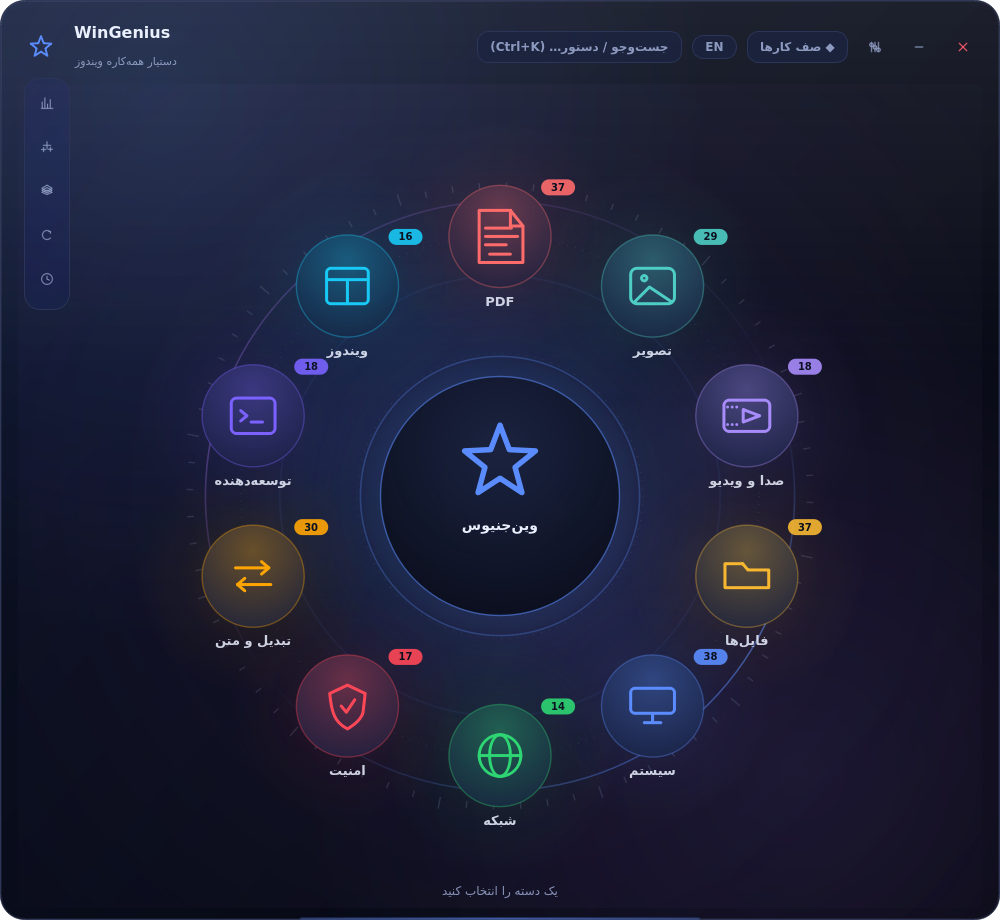
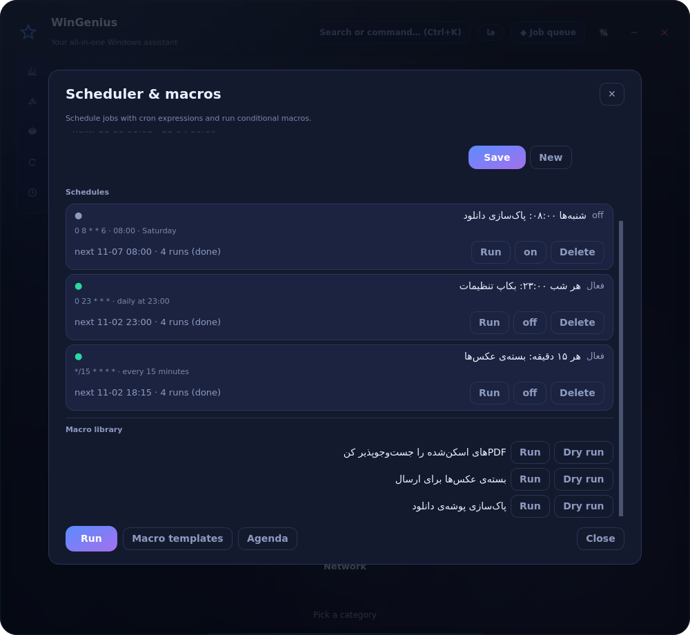

# WinGenius 5.0 — an all-in-one Windows toolbox

> **254 tools · 10 categories · encrypted vault · undo journal · cron scheduler ·
> macro engine · local JSON API.** Persian-first UI with a complete English mode
> (`EN` button, top right — every label, message and tool description is translated).
>
> The full documentation is in Persian in [`../README.md`](../README.md); this page is
> the English entry point.

<p align="center">
  
  
</p>

## What's new in 5.0

* **Digital signatures** — `pdf_sign` signs with a PKCS#12 certificate; `pdf_signature_check`
  lists every signature and **warns when the file changed after signing** (coverage drops from
  `ENTIRE_FILE` to `ENTIRE_REVISION`).
* **Scanned PDFs become searchable** — the FTS5 index spots a missing text layer (little text plus a
  page-sized image), renders the first pages and indexes them with Tesseract. One settings toggle.
* **Crash report bundle** — `crash_report` writes a ZIP with version, diagnostics and log tails after
  stripping home paths, usernames and tokens/keys.
* **65 new checks**, including a `scale` group (600-file rename + undo, 250-document index, timed).

Version 4.2 added:

* **Real PDF redaction** — `pdf_redact` removes the text (or an area) from the content stream, then
  reopens its own output to prove the phrase can no longer be extracted. A black rectangle over text
  is not redaction; this is.
* **Speech to text** — `audio_transcribe` turns audio/video into text and/or `.srt` with Whisper
  (tiny → large-v3), fully local; without an engine it prints the exact install command.
* **Frictionless OCR** — `ocr_setup` reports the engine, remembers an unusual install path and
  downloads Persian/English/Arabic language data. Every OCR tool now honours that path.
* **Windows “Send to”** — `--install-sendto` adds the right-click shortcut; `--sendto <files>` opens
  the app with those files in the smart-drop sheet.
* **Portable mode** — `--portable`, `WINGENIUS_PORTABLE=1` or a `portable.flag` file keeps all data
  next to the exe.
* **Accessibility** — every auto-generated field and nav button has an accessible name that follows
  the fa/en toggle.

Version 4.1 was the hardening + distribution release, and is included here:

* **Vault v2** — scrypt key derivation (`N=2¹⁵`), an *authenticated* header (tampering with the KDF
  parameters is detected, not silently mis-keyed), each payload bound to its entry name, and a
  `vault_upgrade` tool that converts old PBKDF2 vaults in place.
* **Versioned data folder** — `schema.json`, automatic full backup before every migration,
  idempotent migration steps, in-place journal schema upgrades, data version shown in `--doctor`.
* **Single instance** — a second launch focuses the first window instead of writing to the same
  journal and scheduler (`--allow-multi` opts out).
* **Hardened local API** — 300 requests/minute per IP, 1 MiB body limit with a real `413` reaching
  the client, optional token-in-query, clean shutdown.
* **Output-correctness tests** — `tests/output_test.py` opens the file that was produced (80 checks).
* **CI + licensing** — GitHub Actions on Windows and Linux (Python 3.12 & 3.13), `ruff` gate,
  `packaging/verify_package.py`, `LICENSE` (AGPL-3.0) and `THIRD-PARTY-NOTICES.md`.

## What it does

| Area | What you get |
|---|---|
| **PDF** (37) | images ⇄ PDF, merge/split/rotate, compress, text & attachments, crop, page numbers, forms, **real redaction**, **signatures (sign/verify)**, OCR, DOCX→PDF |
| **Images** (29) | convert, resize, compress, watermark, contact sheet, grid split, EXIF, favicon, colour tools |
| **Files** (37) | batch rename, dedupe, sync, shred, encrypt, hashes, tree export, permissions, timestamps |
| **System** (38) | processes, startup impact, disks, services, battery, wifi, drivers, restore points, **OCR setup**, **crash report** |
| **Media** (18) | trim, merge, compress, GIF, frames, audio extract/normalise/tempo, **speech to text + SRT** |
| **Network** (14) | port scan, DNS, HTTP, WHOIS, site check, speed probe (no telemetry; these are the only tools that contact the internet, and only when you run them) |
| **Security** (17) | password/hash tools, breach check (k-anonymity), secret scan, **encrypted vault** (scrypt + authenticated header, in-place upgrade of old vaults) |
| **Convert** (30) | units, timezones, timestamps, bases, colour, tables, CSV↔SQL↔JSON↔YAML |
| **Developer** (18) | regex, diff, JWT, URL, cron, semver, minify, SQL format, `.env` audit |
| **Windows** (16) | applet hub, power actions, screenshot, wallpaper, winget, event errors, WinSxS cleanup, **“Send to” shortcut** |

…plus four non-tool engines:

* **Planner** — describe the job in plain Persian/English (`Ctrl+K`), it proposes a
  workflow you can inspect, edit and run.
* **Workflows & macros** — 10 built-in workflows, conditional macros, dry-run mode.
* **Scheduler** — cron expressions, catch-up for missed runs, agenda view.
* **Journal** — every destructive action is reversible with `Ctrl+Z`; files go to
  the app's own trash, overwrites are snapshotted first.

## Install & run

```bash
pip install -r requirements.txt
python main.py                 # GUI
python main.py --doctor        # environment + dependency report
python main.py --self-test     # headless smoke run
```

Build a Windows exe (on Windows):

```bash
pip install -r requirements-build.txt
python packaging/build_exe.py                 # dist/WinGenius.exe
python packaging/build_exe.py --installer     # dist/WinGenius-Setup.exe (Inno Setup 6)
```

## Command line

```
--list --describe --run --doctor --self-test --version
--list-workflows --run-workflow --plan
--list-schedules --run-schedule --undo
--macros --run-macro [--set key=value --dry-run --json --quiet --lang fa|en]
--serve [--port 8770]
```

## Local API

```bash
python main.py --serve
curl -H "X-WinGenius-Token: $(cat ~/.config/WinGenius/api_token.txt)" \
     http://127.0.0.1:8770/tools?q=pdf
```

Routes: `/health /tools /tools/<id> /workflows /plan?q= POST /run /journal /undo`.
The server binds to `127.0.0.1`, needs a per-install token, throttles bursts
(token bucket, 300 req/min), refuses bodies over 1 MiB and can be told to reject
tokens that arrive in the query string (`allow_query_token=False`).

## Tests

```bash
python tests/smoke_test.py        # 154 real-file checks
python tests/functional_test.py   # 458 engine/tool checks (schema, stress, fuzz, guards, CLI, v42, v50, scale)
python tests/output_test.py       # 112 output-correctness checks (is the file right?)
python tests/ui_test.py           # 1077 UI checks incl. accessibility, offscreen Qt
python tests/security_test.py     # 57 security/consistency regression checks
python -m pytest -q               # 44 collected tests (pytest entry point now works)
python packaging/verify_package.py  # 27 build-input checks
ruff check main.py app tests packaging  # lint gate (real-bug rules only)
```

Everything runs headless (`QT_QPA_PLATFORM=offscreen`) on Linux, Windows and macOS,
in CI (`.github/workflows/ci.yml`) on Python 3.12 and 3.13.
Totals: **154 smoke · 458 functional · 112 output · 1077 UI · 57 security · 27 packaging
= 1,885 checks**. Coverage measures 75%; `pyproject.toml` enforces a 70% `fail_under` gate.

## Security notes

* Vault: **AES-256-GCM** with a **scrypt** (N=2¹⁵) derived key; the container header
  is *authenticated*, so a tampered `log_n`/salt is detected instead of silently
  changing the key. Old PBKDF2 vaults stay readable and can be upgraded in place.
* `zip_extract` refuses path-escape (zip-slip) members instead of writing them.
* Tool crashes never reach the user as a traceback: a global guard turns them into
  a bilingual message and logs the details.
* The local API is loopback-only, token-gated and rate limited.
* **Signatures are real**: signed with a PKCS#12 certificate (pyHanko, optional dependency) and
  verified after signing; a file edited afterwards is reported as changed, not as valid.
* **Redaction is real**: `pdf_redact` rewrites the content stream, so redacted words cannot be
  copied or extracted back out — and the tool verifies this on its own output.

## Licence

**AGPL-3.0-or-later** — see [`../LICENSE`](../LICENSE) and
[`../THIRD-PARTY-NOTICES.md`](../THIRD-PARTY-NOTICES.md) (PyMuPDF is AGPL; the
notices file explains how to switch to a permissive renderer if you need one).

## Data folder

`%APPDATA%\WinGenius` (Windows) or `~/.config/WinGenius` — `settings.ini`,
`history.json`, `journal.sqlite3`, `trash/`, `macros/`, `schedules.json`,
`schema.json` (data version + upgrade history), `backups/` (automatic pre-upgrade
snapshots), `logs/wingenius.log` (rotated), `tessdata/` (language packs fetched by
“OCR setup”). Run with `--portable` (or set `WINGENIUS_PORTABLE=1`) to keep all of it in
a `data/` folder next to the exe instead.
